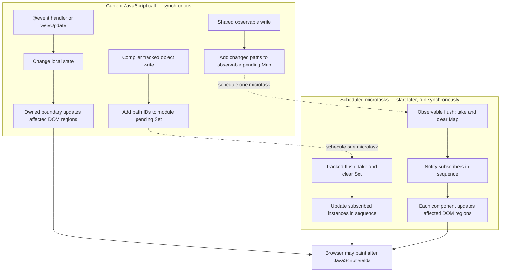

# weivjs

Compiler-first `.weiv` tooling in one package:

- `weiv` CLI
- Vite plugin (`weivjs/vite`)
- Bun plugin (`weivjs/bun`)
- optional `weiv:*` typings (`weiv:observable`, `weiv:router`)

## Install

```bash
npm i -D weivjs
```

Then run:

```bash
npx weiv --help
```

## CLI Usage

```bash
# Dev server
npx weiv dev src/App.weiv

# Emit browser app bundle
npx weiv compile emit app src/App.weiv ./dist

# Emit JS for a component
npx weiv compile emit js src/App.weiv
```

## Writing `.weiv` SFCs

You can build normal components without any `weiv:*` imports.

```html
<template>
  <section>
    <h1>{{ title }}</h1>
    <p>Count: {{ count }}</p>
    <button @click="increment">Increment</button>
  </section>
</template>

<script>
  let title = "Hello Weiv";
  let count = 0;
  function increment() {
    count += 1;
  }
</script>
```

Use `weiv:*` imports only when you need shared state or routing.

### When state changes reach the DOM

Weiv bindings render **from component state to the DOM**. For example,
`:value="name"` writes `name` to an input; it does not copy user edits back to
`name`. An `@input` handler must read the input and assign `name` if that is the
intended behavior.

There are two timing steps to distinguish: **when an update is scheduled** and
**how the update runs once it starts**. Weiv uses these paths:



| Change source | During the current JavaScript call | Later work |
|---|---|---|
| Local state changed by a template `@event` handler or `weivUpdate` | The owned update boundary runs the callback, then synchronously finds changed bindings and updates affected DOM regions. | If the callback returns a Promise, the boundary also checks for changes when it settles. |
| Compiler tracked object or array write | The Proxy records affected path IDs in a pending `Set` scoped to the generated component module. | One scheduled microtask takes and clears those paths, then synchronously updates subscribed instances in sequence. |
| Shared `weiv:observable` write | The Proxy records changed property paths in a pending `Map` scoped to the observable root. | One scheduled microtask takes and clears the map, then synchronously calls each subscriber in sequence. A generated component subscriber synchronously updates its affected DOM regions. |

The `Set` and `Map` are separate mechanisms, not one global change queue. Several
writes before a scheduled flush are combined. Only the **start** of a scheduled
microtask is deferred: its callback and the component updates inside it run
synchronously until they return. For a shared observable used by components A
and B, the sequence is:

```text
Current call:       write observable → record change → schedule notification microtask
After call returns: notification microtask starts
                   → notify A → update A's DOM
                   → notify B → update B's DOM
                   → notification microtask ends
Later:              browser may paint a frame containing both updates
```

DOM writes take effect immediately in the in-memory DOM. The browser decides
when to paint; Weiv does not force a paint after each component update. If an
owned event boundary consumes pending compiler tracked paths, its scheduled
tracked flush may later find its `Set` empty. That does not clear a shared
observable's pending `Map` or suppress its subscriber notifications.

### Updates from external callbacks

Weiv flushes local state changes automatically after template handlers such as
`@click="openFiles"`. It also owns callbacks passed to the component script's
locally wrapped `setTimeout`, `setInterval`, `queueMicrotask`, and
`requestAnimationFrame`.

A callback registered with another API runs outside that update boundary. If it
changes template-bound local state, wrap the change in `weivUpdate`. This applies
to browser listeners, Tauri events, external stores, and similar subscriptions.
**The `weivUpdate` examples below require `weivjs@0.1.2` or newer; published
`0.1.1` does not provide it.** See the `0.1.1` workaround below. With `0.1.2`,
a keyboard shortcut can update a panel directly:

```html
<script lang="ts">
  let panelMode = "none";

  window.addEventListener("keydown", (event) => {
    if (!(event.metaKey && event.key.toLowerCase() === "p")) return;
    weivUpdate(() => {
      panelMode = "files";
    });
  });
</script>
```

The same pattern works with Tauri's event API:

```html
<script lang="ts">
  import { listen } from "@tauri-apps/api/event";

  let latestRunText = "";
  listen<string>("run-event", (event) => {
    weivUpdate(() => {
      latestRunText = event.payload;
    });
  });
</script>
```

`weivUpdate` is available inside each `.weiv` component script in `0.1.2` and
newer. Do not import or declare it. It runs the callback immediately,
then flushes changed bindings.
If the callback returns a Promise, it flushes again when the Promise settles.
Call it in the external callback at the point where state changes. A hidden
button or synthetic click is unnecessary. If no component state changes, no
update boundary is needed. Clean up external subscriptions when their lifetime
should end; `weivUpdate` handles updates, not listener disposal.

**Published `weivjs@0.1.1` caveat:** that release does not inject `weivUpdate`
into component scripts. Calling it throws `ReferenceError: weivUpdate is not
defined`. In `0.1.1`, schedule the state change through the component script's
locally wrapped `queueMicrotask`, which runs its callback in Weiv's update
boundary:

```html
<script lang="ts">
  let panelMode = "none";

  window.addEventListener("keydown", (event) => {
    if (!(event.metaKey && event.key.toLowerCase() === "p")) return;
    queueMicrotask(() => {
      panelMode = "files";
    });
  });
</script>
```

For a Tauri subscription in `0.1.1`, also defer registration to a microtask:
that package initializes imported aliases after top-level component script
calls, so a direct top-level `listen(...)` can fail before mount.

```html
<script lang="ts">
  import { listen } from "@tauri-apps/api/event";

  let latestRunText = "";
  queueMicrotask(() => {
    listen<string>("run-event", (event) => {
      queueMicrotask(() => {
        latestRunText = event.payload;
      });
    });
  });
</script>
```

A focused `0.1.1` browser-event fixture was compiled and mounted to verify
that the rendered state updates after the microtask. Upgrade to `0.1.2` to
use `weivUpdate` directly.

### DOM bindings and input state

Weiv directives always begin with a symbol:

- `:name` binds a DOM property, attribute, or component prop.
- `@event` handles a DOM or component event.
- `#if`, `#else`, and `#for` control template structure.

The older `bind:name` and `on:event` spellings are deprecated compatibility
syntax. They remain accepted for now, but new and migrated code should use the
symbol forms.

Structural directives use `#` so they cannot be confused with ordinary HTML
attributes:

```html
<label for="email">Email</label>
<article #for="item in items">
  <p #if="item.visible">{{ item.label }}</p>
  <p #else>Hidden</p>
</article>
```

Bare `if`, `else`, and `for` are ordinary attributes. This keeps native and
custom-element attributes available without special escaping.

Binding directives write component state to DOM properties and attributes; they
are one-way. In particular, `:value`/`bind:value` does not write user edits back
to the component variable. Handle the input event explicitly when component
state must track the field:

```html
<input :value="draftName" @input="updateDraftName" />

<script lang="ts">
  let draftName = "";

  function updateDraftName(event: Event) {
    draftName = (event.currentTarget as HTMLInputElement).value;
  }
</script>
```

### Global styles

Component styles are scoped by default. Wrap a whole selector in `:global(...)`
when it must apply outside the component scope:

```css
:global(:root) {
  --ink: #193047;
}

:global(body) {
  margin: 0;
}
```

Shared state example:

```ts
// state/counter.ts
import { observable } from "weiv:observable";

export const counter = observable({
  value: 0
});
```

```html
<template>
  <div>
    <p>Shared: {{ counter.value }}</p>
    <button @click="counter.value += 1">Add</button>
  </div>
</template>

<script>
  import { counter } from "./state/counter.ts";
</script>
```

Router example:

```ts
import { createRouter } from "weiv:router";

export const router = createRouter({
  routes: [
    { path: "/", component: () => import("./views/Home.mjs") },
    { path: "/about", component: () => import("./views/About.mjs") }
  ],
  target: document.getElementById("app")
});
```

## Vite Plugin

```ts
// vite.config.ts
import { defineConfig } from "vite";
import { weiv } from "weivjs/vite";

export default defineConfig({
  plugins: [weiv()]
});
```

You can then import `.weiv` files directly in your app. The plugin emits both
the component JavaScript and its scoped `<style>` CSS through Vite.

## Bun Plugin

```ts
// bunfig.toml uses a JS/TS plugin file, for example build.ts
import { weiv } from "weivjs/bun";

export default {
  plugins: [weiv()]
};
```

## Optional `weiv:*` Typings

This package ships optional typing support for:

- `weiv:observable`
- `weiv:router`

Use these when needed in your app or generated code.
